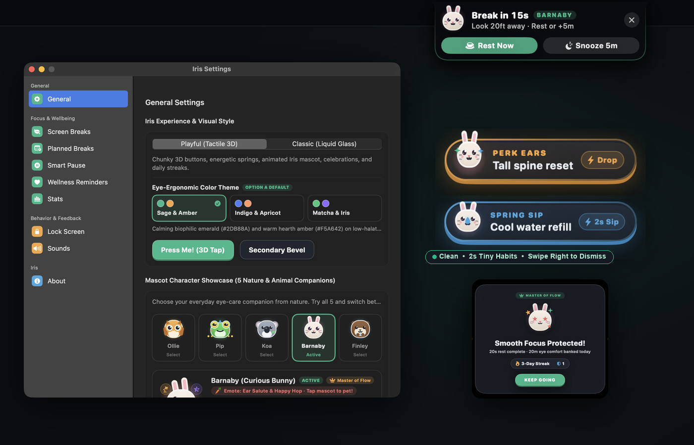
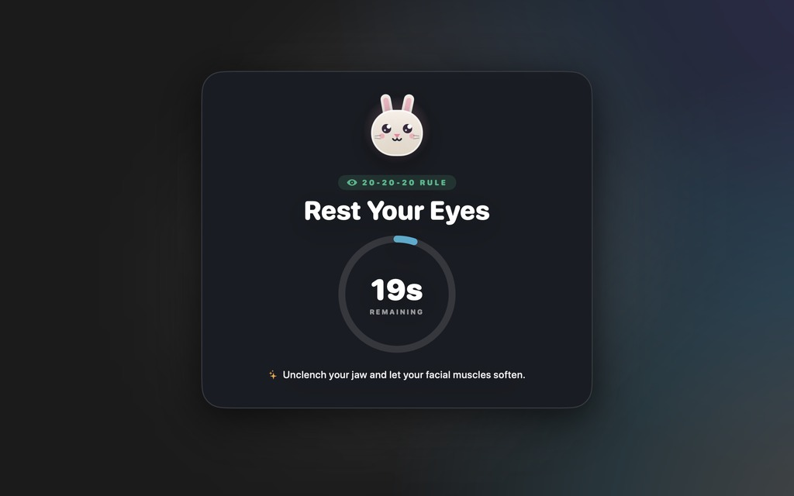
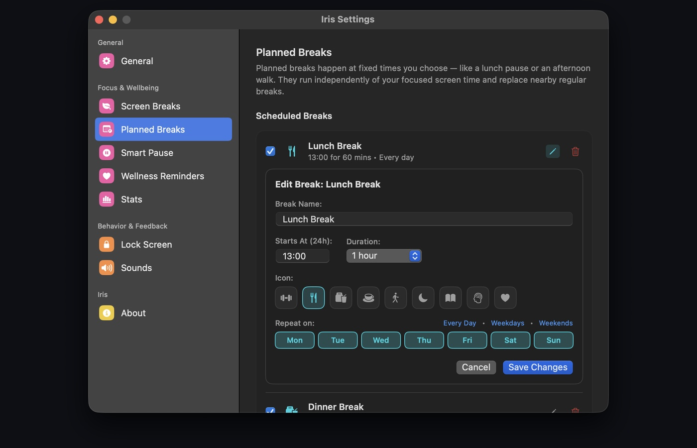

# Iris for macOS 👁️✨

<p align="center">
  
</p>

<p align="center">
  <strong>Native, lightweight macOS break reminder and eye-strain prevention application.</strong><br>
  Protect your eyesight, combat digital eye strain with the 20-20-20 rule, and build mindful work rhythms.
</p>

<p align="center">
  <a href="https://github.com/harshwardhangalande/Iris/releases/latest"></a>
  <a href="https://github.com/harshwardhangalande/Iris/releases"></a>
  
  
  
  <a href="LICENSE"></a>
  <a href="https://buymeacoffee.com/harshwardhangalande"></a>
</p>

<p align="center">
  <a href="#-whats-new-in-v311">What's New</a> •
  <a href="#-quick-download">Quick Download</a> •
  <a href="#-features">Features</a> •
  <a href="#-screenshots">Screenshots</a> •
  <a href="#-comparison">Comparison</a> •
  <a href="#-faq">FAQ</a> •
  <a href="https://github.com/harshwardhangalande/Iris/releases">Releases</a> •
  <a href="https://buymeacoffee.com/harshwardhangalande">Buy Me a Coffee ☕</a>
</p>

---

## 🎯 What is Iris?

**Iris** is a lightweight, menu bar resident macOS freeware utility engineered to combat Computer Vision Syndrome (CVS), headaches, and eye fatigue caused by prolonged screen time. 

Built natively in **SwiftUI** and **AppKit** with Apple's Liquid Glass aesthetics, Iris automatically guides you through the scientifically proven **20-20-20 rule**: *every 20 minutes, look at an object 20 feet (6 meters) away for at least 20 seconds*.

Unlike heavyweight Electron alternatives, Iris consumes virtually **zero CPU**, runs entirely without dock clutter (`LSUIElement = true`), respects your privacy with **zero telemetry or analytics**, and integrates deeply with native macOS technologies like **Force Touch Trackpad Haptics**, **IOKit HID Idle Detection**, and **CoreAudio / MediaRemote**.

---

## 🆕 What's New in v3.1.1

* **Inline Monthly Insights Calendar**: Click the top-left **Calendar** icon in the `Stats` tab to smoothly unfold a full-month analytics view inside the menu bar popover — featuring a 4-tile monthly summary strip (**Avg Score**, **Active Time**, **Rests**, **Habits**), a color-coded daily heatmap grid, tap-to-inspect day navigation, and responsive forward/back day arrows.
* **Interactive Identity Rank Ladder & 3-Ring Screen Score**: Click your **Identity Rank** badge (`Mindful Starter` `0–4` → `Focus Apprentice` `5–19` → `Rhythm Keeper` `20–49` → `Vision Guardian` `50–99` → `Master of Flow` `100+`) to open the full rank progression chart, and click **What is screen score?** for the **3 Rainbow Gauge Rings** legend (*Outer Violet*: Overall Screen Score %, *Middle Amber*: Break Compliance, *Inner Teal*: Micro-Habits `0–8`).
* **Buy Me a Coffee Support**: Added a creative animated steaming-cup support button across Settings (`About` Spotlight & sidebar footer), Menu Bar popover, gear menu, and GitHub Pages (`buymeacoffee.com/harshwardhangalande`).
* **Decluttered Liquid Glass & Circular Wellness Pills**: Unified continuous squircle card geometry across the popover, break overlays, and Settings while reserving floating Hero `Capsule` CTAs, restored sleek circular `Capsule` wellness reminder pills, eliminated duplicate gauge score labels, added breathing room above `Optimal`, and aligned the `7-Day Trend` & `Week Avg` flank cards.
* **Reliable Browser Video Auto-Pause**: Upgraded `MediaPlaybackManager` with CoreAudio per-process output monitoring (`kAudioHardwarePropertyProcessObjectList`), multi-client `MediaRemote` dispatching, pause-before-mute sequencing, and Accessibility keyboard fallback so embedded & HLS browser streams (Safari, Brave, Chrome, Edge, Arc, Firefox) reliably pause even alongside paused background media players.

---

## 📸 Screenshots

| Menu Bar Screen Score & Stats | Menu Bar Resident Now Countdown |
| :---: | :---: |
|  |  |

| Notch Whisper, Swipe Popups & Themes | Full-Screen 20-20-20 Rest Overlay |
| :---: | :---: |
|  |  |

| Scheduled Planned Breaks Editor | Force Touch Trackpad Haptics & Sounds |
| :---: | :---: |
|  |  |

---

## ✨ Core Features

### 1. Liquid Glass Menu Bar Popover, Monthly Calendar & 3-Ring Screen Score
* **Live Resident Countdown & Rolling Digits**: Displays remaining work time (`18m`) or break duration (`20s`) alongside the monochrome Iris template emblem, paired with smooth rolling `numericText` countdown digits inside the popover.
* **Inline Monthly Insights Calendar & Day Switcher**: Click the top-left **Calendar** icon on the `Stats` tab to smoothly unfold a full-month dashboard inside the menu bar card—showing **Avg Score**, **Active Time**, **Rests**, and **Habits** KPIs alongside a tap-to-inspect heatmap grid and seamless `<` / `>` day navigation.
* **Liquid Island Notch Whisper & Typing Grace**: Alcove-inspired obsidian lip that springs seamlessly out of your MacBook notch (with blur-in reveal and warm amber final-5s shift), waits gently when you're mid-sentence (`Finishing thought...` typing grace up to 15s), peeks non-blocking **Welcome Back** toasts with 1-tap **Undo Reset** after long idle breaks, and expands on hover with **Rest Now** and **Snooze 5m**.
* **Fluid Sliding Tab Carousel & 4-Node Constellation**: Seamless spring glide between the **Now** view (cursor-tracking mascot gaze, clickable pet reactions, luminous 4-node **Eyes · Water · Posture · Move** constellation with ascending pentatonic win chimes, and glowing streak pill) and the **Stats** dashboard.
* **Decluttered 3-Ring Rainbow Screen Score Gauge**: Sweeps in with 3 concentric rings—**Outer Violet** (*Overall Screen Score %*), **Middle Amber** (*Break Compliance*), and **Inner Teal** (*Micro-Habits 0–8*)—flanked symmetrically by aligned **7-Day Trend** & **Week Avg** cards, extra breathing space above the **Optimal** pill, and an interactive **What is screen score?** legend.
* **Accurate Ocular Health Calculation & Rest Shields**: Penalties apply strictly for skipped breaks, recovery credits reward completed micro-habits, and **Rest Shields** (plus **Crunch / Weekend Pause**) protect your daily streak from unexpected crunch days.
* **Cohesive Squircle Theme & Hero Capsules**: Built with macOS `NSVisualEffectView` behind-window blending, unified continuous squircle radii across settings and status tiles, and tactile Hero `Capsule` CTAs.

### 2. Nature Mascots, Companion Sanctuary & Identity Rank Ladder
* **5 Unique Nature Companions & 25 Choreographed Emotes**: Choose between **Ollie (Owl)**, **Pip (Tree Frog)**, **Koa (Zen Koala)**, **Barnaby (Bunny)**, and **Finley (Sea Otter)**—each performing **5 unique articulated emotes** across Posture, Water, Blink, Stretch, and Breath popups.
* **Sequential Swipe-to-Dismiss Popups & 2-Second Tiny Habits**: Popups appear one by one in sleek circular `Capsule` pills without overlap, adapt copy to time of day and focus rhythm, include a frictionless **2s Tiny Win** quick-credit chip (`2s Sip`, `3× Blink`, `Drop Shoulders`, `Quick Reach`, `1 Exhale`), and dismiss cleanly with a **right swipe** on trackpad or mouse.
* **Companion Sanctuary & Interactive Identity Rank Chart**: Completed rests permanently unlock desk habitat props (*Matcha Mug*, *Sage Fern*, *Amber Lamp*, *Horizon Star*, *Zen Cushion*) and advance your **Identity Rank** (*Mindful Starter* `0–4`, *Focus Apprentice* `5–19`, *Rhythm Keeper* `20–49`, *Vision Guardian* `50–99`, *Master of Flow* `100+`). Click your rank badge in the popover or Settings anytime to view the full tier progression chart.
* **Eye-Ergonomic Color Themes & Tactile 3D Buttons**: Select between **Sage & Amber** *(Option A default)*, **Indigo & Apricot**, and **Matcha & Iris** palettes, paired with pressable 3D spring buttons and **Peak-End Break Finale** celebrations.
* **Playful / Classic Switcher**: One-click style toggle in Settings to switch between Playful mode and sleek Classic Liquid Glass minimalism.

### 3. 20-20-20 Rest & Long Breaks
* **Frosted Blur-to-Calm Entry & Guided Breathing Halo**: Entering a break settles smoothly via frosted focus-ramp depth (`Blur-to-Calm`), accompanied by an optional 4-3-5 guided breathing halo (`Inhale · Soften gaze` → `Hold · Look 20 ft away` → `Exhale · Relax eyes`) and your interactive Sanctuary desk props.
* **Short Breaks (20-20-20 Rule)**: Automatically triggers every 20 minutes for 20 seconds with breathing and distance relaxation prompts.
* **Long Rest Cycles**: Configurable longer breaks (e.g. 5 minutes every hour) to stretch, hydrate, and move.
* **Multi-Display Coverage**: Covers all connected external monitors and laptops simultaneously at `.screenSaver` window level.
* **Visual Themes**: Choose between ambient fluid animations (*Aurora Glow*, *Flowing Waves*, *Floating Fireflies*, *Frosted Glass*) or tactile screen-split textures (*Leather*, *Linen*, *Cutting Mat*, *Brushed Metal*).

### 4. Scheduled Planned Breaks
* **Fixed Daily Routines**: Schedule recurring breaks for Gym, Lunch, Dinner, Walks, or Evening Wind Down.
* **Rich Inline Editor**: Customize start times (24h format), durations (5m to 2h), custom SF Symbols, and day-of-week repeat rules (Every Day, Weekdays, Weekends).

### 5. Apple Force Touch Trackpad Haptics
* **Physical Tactile Feedback**: Uses macOS `NSHapticFeedbackManager` to deliver subtle physical sensations directly to your MacBook Force Touch trackpad.
* **Sensory Highlights**:
  * *Break Completion Heartbeat*: Physical latch click (`.alignment`) followed by a gentle secondary echo pulse.
  * *Break Start Snap*: Mechanical snap when entering rest mode.
  * *Final 3-Second Ticks*: Stepping notch clicks (`.levelChange`) on 3, 2, 1 countdown.
  * *Control Taps*: Crisp feedback for buttons, toggles, and date navigation.

### 6. Smart Pause & System Intelligence
* **Meeting & Call Detection**: Automatically pauses break reminders during Zoom, Google Meet, Microsoft Teams, Webex, FaceTime, and Slack calls.
* **Screen Sharing & Recording**: Suppresses prompts when sharing screens via OBS, QuickTime, or conferencing tools.
* **Automatic Video Playback Muting**: Detects active full-screen video playback (YouTube, Netflix, QuickTime, VLC, etc.) and automatically mutes reminder audio to prevent interruptions.
* **Screen Edge Warning Glow**: Displays a gentle ambient edge glow 5s–60s prior to break start with smooth multi-stop gradient falloff.
* **System Idle Detection**: Uses `IOHIDSystem` (`HIDIdleTime`) to detect when you walk away from your desk, automatically pausing and resetting counters upon your return.
* **Automatic Media Pause (Browser & Desktop)**: Combines CoreAudio per-process output detection (`kAudioHardwarePropertyProcessObjectList`), multi-client `MediaRemote` dispatching, pause-before-mute sequencing, and Accessibility keyboard fallback to pause music or embedded/HLS browser video players (Safari, Brave, Chrome, Edge, Arc, Firefox, IINA, VLC) when a break starts—even alongside paused background apps—and resumes playback after your break.

### 7. Discipline Modes
* **Gentle**: Skip breaks with a single tap or the `Esc` key.
* **Firm**: Enforces a 3-second cooldown before skipping (plus configurable Double-`Esc` skip/snooze action) to prevent accidental or impulsive skips.
* **Strict**: Unskippable break screen with emergency exit (`⌘⇧Esc`) only.

### 8. Compact Swipeable Wellness Popups & 2s Tiny Habits
* One-by-one sequential circular `Capsule` micro-reminders for **Posture Correction**, **Drinking Water**, **Eye Blinking**, **Stretching**, and **Deep Breathing**, starring all 5 mascots with 25 bespoke animated emotes.
* **Right-Swipe to Dismiss & 2-Second Tiny Habits**: Tap anywhere on a popup pill to complete, swipe right to dismiss previews, or tap the compact habit chip (`2s Sip`, `3× Blink`, `Drop`, `Reach`, `Exhale`) for instant wellness credit.
* **Custom Screen Positioning**: In-app vertical (2% to 90%) and horizontal position sliders with smooth, unclipped ambient bloom.

---

## 📊 Feature Comparison

| Feature | Iris (Freeware) | LookAway ($19-$29) | Time Out | Generic Pomodoro |
| :--- | :---: | :---: | :---: | :---: |
| **Price** | **100% Free for Personal Use** | Commercial / Paid | Freemium | Free / Paid |
| **Native macOS Architecture** | **SwiftUI + AppKit (Universal)** | Swift | Swift | Often Electron |
| **Force Touch Trackpad Haptics** | **Yes (Heartbeat, ticks, snaps)** | No | No | No |
| **Liquid Glass Menu Bar UI** | **Yes (Sonoma/Sequoia blur)** | Yes | No | No |
| **Inline Monthly Insights Calendar** | **Yes (Heatmap + Avg/Rests/Habits)** | No | No | No |
| **Identity Rank Chart & 3-Ring Score** | **Yes (Starter → Master of Flow)** | No | No | No |
| **Adaptive Notch Whisper** | **Yes (Hover Expand + Toggle)** | No | No | No |
| **Swipe Popups & 25 Mascot Emotes** | **Yes (5 Companions + Sanctuary)** | No | No | No |
| **Rest Shields & Ergonomic Palettes** | **Yes (3 Palettes + Peak-End Finale)** | No | No | No |
| **Browser Video & Audio Auto-Pause** | **Yes (CoreAudio + MediaRemote)** | Yes | Partial | No |
| **Multi-Display Fullscreen Overlay** | **Yes** | Yes | Yes | Rarely |
| **Meeting & Screen Share Auto-Pause** | **Yes** | Yes | Partial | No |
| **Hardware HID Idle Detection** | **Yes** | Yes | Yes | No |
| **Planned Scheduled Breaks** | **Yes (Gym, Lunch, Wind Down)** | Yes | No | No |
| **Telemetry & Tracking** | **Zero (100% Offline)** | Proprietary | Proprietary | Varies |

---

## 📥 Quick Download

### Option 1: Homebrew (Recommended)
```bash
brew install --cask harshwardhangalande/iris/iris
```

### Option 2: DMG Installer
Download the latest disk image from the [Releases Page](https://github.com/harshwardhangalande/Iris/releases/latest):
* ⬇️ **[Download Iris-v3.1.1.dmg](https://github.com/harshwardhangalande/Iris/releases/download/v3.1.1/Iris-v3.1.1.dmg)**
* Open the DMG and drag **Iris** to your **Applications** folder.

### Option 3: Direct Zip
* ⬇️ **[Download Iris-v3.1.1.zip](https://github.com/harshwardhangalande/Iris/releases/download/v3.1.1/Iris-v3.1.1.zip)**
* Extract and move `Iris.app` into `/Applications`.

### Option 4: Terminal One-Liner
```bash
TMPDIR_IRIS=$(mktemp -d) && MNT_IRIS=$(mktemp -d) && \
curl -fsSL "https://github.com/harshwardhangalande/Iris/releases/download/v3.1.1/Iris-v3.1.1.dmg" -o "$TMPDIR_IRIS/Iris.dmg" && \
hdiutil attach "$TMPDIR_IRIS/Iris.dmg" -nobrowse -mountpoint "$MNT_IRIS" && \
cp -R "$MNT_IRIS/Iris.app" "/Applications/" && \
hdiutil detach "$MNT_IRIS" && rm -rf "$TMPDIR_IRIS" "$MNT_IRIS"
```

---

## ❓ Frequently Asked Questions (FAQ)

### What is the 20-20-20 rule and why does it help prevent eye strain?
The 20-20-20 rule is an optometry guideline recommended by the American Academy of Ophthalmology: every 20 minutes spent looking at a digital screen, look at an object at least 20 feet away for at least 20 seconds. Looking into the distance allows the ciliary muscles in your eyes to completely relax, preventing dry eyes, blurred vision, headaches, and computer fatigue.

### How does Iris differ from standard Pomodoro timers?
Standard Pomodoro apps focus strictly on 25-minute productivity sprints and task management. Iris is specifically engineered for **ocular health and ergonomics**: it enforces rapid 20-second distance-focus breaks, offers micro-reminders to blink and hydrate, monitors camera/mic activity to avoid interrupting client meetings, and calculates a personalized daily Eye Health Score.

### Does Iris work across multiple monitors?
Yes. Iris automatically detects all active screens, including built-in Retina displays, external 4K/5K monitors, and Sidecar iPads, presenting synchronous relaxation overlays across all connected displays simultaneously.

### Does Iris consume battery or run heavy background processes?
No. Iris is written in pure native Swift with no web wrappers (Electron/Chromium). When not in a break, Iris is purely event-driven and draws virtually 0.0% CPU, making it battery-friendly for MacBook users on the go.

### Is my activity tracked or sent to the cloud?
No. Iris operates 100% locally on your machine. All settings and eye health scores are stored locally in macOS `UserDefaults`. No network requests are made, no user analytics are collected, and no accounts are required.

---

## 🤝 Feedback & Community
Feature suggestions, feedback, and bug reports are warmly welcome!
* Support Iris development on [Buy Me a Coffee](https://buymeacoffee.com/harshwardhangalande).
* Submit bug reports and feature requests on [GitHub Issues](https://github.com/harshwardhangalande/Iris/issues).
* Join discussions and share feedback on [GitHub Discussions](https://github.com/harshwardhangalande/Iris/discussions).

---

## 📄 License & Distribution
Iris for macOS is distributed freely for personal use as a compiled binary application.

**Copyright © 2026 Harshwardhan Galande. All rights reserved.**  
Unauthorized commercial distribution, repackaging, resale, or publishing on third-party app stores without express prior written consent is strictly prohibited.
